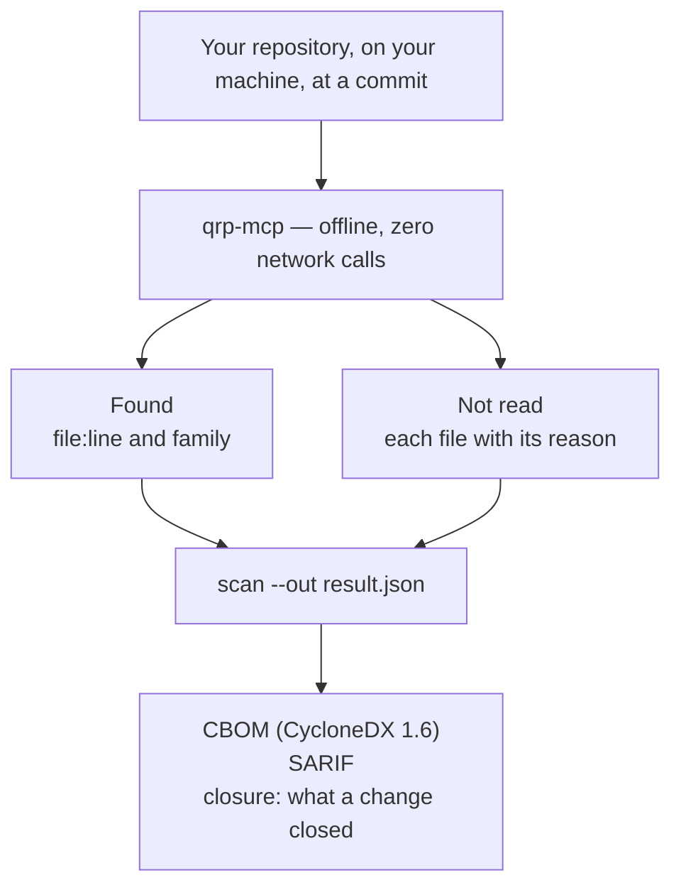

# qrp-mcp

<!-- mcp-name: eu.quantumreadiness/qrp-mcp -->

**A local cryptographic inventory for developers and AI agents that carries verifiable coverage
and its own limits inside the CBOM.**

Every signature in your wallet, contract and validator rests on elliptic-curve cryptography, and
a large quantum computer breaks it. Plenty of tools will tell you what they found. This one also
tells you what it read, what it could not read, and which question it is not answering — in the
document itself, where an auditor can check it rather than take your word.

An MCP server that scans a local directory for cryptography that Shor's algorithm defeats —
secp256k1, Ed25519, BLS, Schnorr, RSA — plus weak primitives and CI signing commands, and
classifies each one: broken by a quantum computer, post-quantum, or neither.

**Everything runs on your machine.** No network calls, no account, no API key, nothing
uploaded. A tool that reads your keys' surroundings has no business phoning home, so this one
makes zero outbound connections — enforced by a test, not promised in a paragraph. The only process it
starts is a local `git`, to pin what it read, with the scanned repository's own hooks and filters disarmed.



Need a cryptographic inventory (a CBOM) for a post-quantum migration or an audit, without
uploading your code? One command, no install step:

```
uvx qrp-mcp scan ~/code/my-project --out result.json
```

What comes back, run on this repository's own test fixtures -- the findings, and next to them
what the scan did not read:

```text
"verdict": "This scan read 24 of 27 files (88.89%); the remaining 3 (1 of 1, by extension
            — .b64 — being 100.0% of them) are listed with a reason each."
"summary": { "total_findings": 10, "quantum_vulnerable_count": 6, "pqc_ready_count": 1,
             "weak_count": 1, "pqc_readiness": "hybrid_partial", ... }
```

## Why this matters for chains and wallets

Bitcoin and Ethereum authenticate with **ECDSA over secp256k1**. Solana, Cardano and Polkadot
use **Ed25519**. Ethereum's consensus layer aggregates with **BLS12-381**. Taproot adds
**Schnorr**.

All four are public-key schemes whose security rests on discrete-log hardness — and all four
fall to the same quantum algorithm. The practical consequence is specific: **once a public key
is exposed, the private key becomes derivable.** Reused addresses, on-chain public keys,
and long-lived validator keys are where that exposure already exists today.

None of this is a prediction about dates. It is an inventory question: *which of my code paths
sign with what?* That question has an answer right now, and this tool gives it.

## Quick start

Add it to your MCP client — no installation step, `uvx` fetches and runs it:

```json
{
  "mcpServers": {
    "qrp": {
      "command": "uvx",
      "args": ["qrp-mcp"]
    }
  }
}
```

Then ask your agent:

> Scan ~/code/my-protocol for quantum-vulnerable cryptography.

### As a Claude Code plugin

The same server, packaged with a skill, so there is no config file to edit:

```
/plugin marketplace add StanimirTenev/qrp-mcp
/plugin install qrp@quantumreadiness
```

Then `/qrp:pqc-scan` in any project. Both routes need [`uv`](https://docs.astral.sh/uv/) on
your PATH, since `uvx` is what fetches and runs the server.

### Without an agent: write the result to a file

```
uvx qrp-mcp scan ~/code/my-protocol --out result.json
```

This produces the same result as the `scan_repo` tool, written to a file you can read
before it goes anywhere. Nothing is sent. By default (from 0.40.0, as `cbom` since 0.16.0 and
the tools) the quoted line is masked: everything in it but the algorithm name is starred out.
`--level full` writes the line as it is, and `--level trimmed` removes the line altogether; all
three keep each file and line number. The SHA-256 of the written bytes is printed,
so anyone you send the file to can quote back exactly what they received.

That digest is the file's integrity, and the file holds its read times, so two runs over one
commit print different ones. Beside it, `findings sha256` is the fingerprint of the findings
alone (`findings_fingerprint` in the JSON, in SARIF's run properties and in the CBOM as
`qrp:findings_fingerprint:sha256`): the same on every run and at every `--level` that finds the
same, different when a finding is added or removed. Its normalisation rules are written into the
output beside it: each finding as family, raw value, classification and severity; each
occurrence as category, path, line, family, role and key size; excerpts, confidence, owners,
baseline state, mandate clauses, suppressed rows, coverage and the read window left out; both
lists sorted, serialised as compact JSON with sorted keys, SHA-256 in hex. It says the result
repeats; it says nothing about whether the result is complete.

```
uvx qrp-mcp cbom ~/code/my-protocol --out cbom.json
uvx qrp-mcp closure before.json after.json --out closure.json
```

`cbom` writes the same CycloneDX document as the `export_cbom` tool, masked by default because
it is the document built to be sent. `closure` writes the `prove_closure` verdict for two saved
scans, and names both inputs by their SHA-256, so the three files can be tied together by
whoever receives them. Both print the SHA-256 of what they wrote.

From 0.46.0 a TLS version a file pins is linked, in CycloneDX's own fields, to what the same file
configures: the TLS groups in `protocolProperties.cryptoRefArray`, and the cipher suites in
`protocolProperties.cipherSuites` by their IANA names, each pointing at the algorithms it names. A
reader that skips `qrp:` properties can resolve the key exchange of `TLS 1.3`
([details](https://github.com/StanimirTenev/qrp-mcp/blob/main/docs/cbom.md)).

From 0.47.0 an algorithm read only from the name of a certificate or key file a TLS setting loads
(`ssl_certificate /etc/nginx/certs/mldsa65_srv.crt;`) is marked `named_in_a_path: true` and is one
confidence level lower: the file's name is a label, not the certificate.

From 0.47.0 `tls_listeners` lists each nginx `server` block that listens with `ssl` or `quic`: its
ports, server names (masked below `--level full`), the groups and the certificates set for it, with
each one's family, so two servers in one file no longer read as one inventory. The CBOM carries it
as `qrp:tls_listeners` ([details](https://github.com/StanimirTenev/qrp-mcp/blob/main/docs/tls.md)).

From 0.48.0 `--mandate` also takes the deadlines of the EU (`eu-pqc-roadmap`), the UK (`uk-ncsc`),
Canada (`ca-cccs`), Australia (`au-ism`), the Netherlands (`nl-rqs`), Sweden (`se-ncsc`), Japan
(`jp-gov`), Singapore's CII owners (`sg-csa-cii`), India (`in-dst`) and Germany (`de-bsi`), each
quoted from the authority's own document, so a finding says which deadline catches it in each.
A date for a class of system the scan cannot see -- high-risk, highest priority -- is said beside
the clause and not counted by the gate. Every mandate block says how old its reading of the
document is, and past 180 days (`stale`) the command line says so
([details](https://github.com/StanimirTenev/qrp-mcp/blob/main/docs/gate-and-suppression.md)).

From 0.49.0 `--mandate` also takes four financial regulators whose duty dates no line of code --
Bank of Israel (`il-boi`), FINMA (`ch-finma`), HKMA (`hk-hkma`) and MAS (`sg-mas`, a
consultation): the sector and the duty, quoted, with no clause on any occurrence and a gate that
never counts them. A mandate block also carries the sha256 of each document as it was read, and
`qrp-mcp mandate-check NAME --document FILE` says whether a copy you downloaded is still the same
document (the tool itself still fetches nothing)
([details](https://github.com/StanimirTenev/qrp-mcp/blob/main/docs/gate-and-suppression.md)).

Four of the mandates also date symmetric or hash algorithms, which the scan does not read:
`cnsa-2.0` (AES-256 and SHA-384/512, already required), `au-ism` (AES-128/192, SHA-224/256 and
HMAC-SHA256 "will not be approved beyond 2030", for interoperability and maintainability reasons),
`ca-cccs` and `nist-ir-8547` (the 112-bit tail by 2030). From 0.49.0 their blocks say
`symmetric: not_established`, quoting the document, and a gate that would pass reads
`not_established` instead -- the exit code stays that of a pass. Before, AES-128 and SHA-256 code
passed `--mandate cnsa-2.0` in silence.

From 0.49.0 `trust_stores` lists each place that loads a trust store (Python `cafile`, Go
`AppendCertsFromPEM`, nginx `ssl_client_certificate`), the anchors read in it, and whether its
path is outside the tree; a strongSwan proposal that can be negotiated with a classical key
exchange alone is a row of its own (`evidence.ike_proposals`), so removing the fallback is
closed; a KMS SDK call (boto3 KMS, Azure Key Vault) says `key_location: kms`; and every evidence
row with a path says `in_test_code`
([details](https://github.com/StanimirTenev/qrp-mcp/blob/main/docs/tls.md)).

From 0.47.0 `--mandate nist-ir-8547` also gives each clause `federal_high_value_assets`: the date
by role that NIST IR 8547 (section 4) restates from EO 14412 and OMB M-26-15 -- post-quantum key
establishment by 2030-12-31, signatures by 2031-12-31 -- for federal high value assets and high
impact systems only. The scan cannot tell which systems those are, so the gate does not count it
([details](https://github.com/StanimirTenev/qrp-mcp/blob/main/docs/gate-and-suppression.md)).

From 0.47.0 an RSA, EC, ECDSA, EdDSA or DSA line that calls `.sign(`, `.verify(`, `.encrypt(` or
`.decrypt(` on a key carries `operation`, so verifying an old signature no longer reads the same
as signing a new one; in the CBOM as `qrp:operation`. Under `--mandate nist-ir-8547` a verify-only or decrypt-only line
says what IR 8547 calls legacy use, with no exemption: the dates and the gate are unchanged
([details](https://github.com/StanimirTenev/qrp-mcp/blob/main/docs/closure-and-profiles.md)).

From 0.47.0 a call into a post-quantum KEM or signature API is a row with `operation` --
`keygen` apart from `encapsulate`, `decapsulate`, `sign` and `verify` -- so where a device
generates its own key is said with file and line: the NIST API of pqm4, PQClean and SUPERCOP
(`crypto_kem_keypair/enc/dec`, `crypto_sign_keypair`, `crypto_sign_signature`/`crypto_sign`,
`crypto_sign_verify`/`crypto_sign_open`), liboqs (`OQS_KEM_keypair/encaps/decaps`,
`OQS_SIG_keypair/sign/verify` and the per-scheme forms) and mlkem-native's namespaced
functions. Where the call does not name the scheme, the family is the one the same file names
(`family_named_at`), and a family named there only in a comment stays not used; a file naming
none or two gives no row. Declarations are not calls. Code
shows where a key is generated, not whether that step survives a fault.

From 0.47.0 RustCrypto's `ml_kem`, `ml_dsa` and `slh_dsa` crates and libcrux are named as the
`provider`, and Go's `mlkem.GenerateKey768()` and its siblings give the parameter set
([details](https://github.com/StanimirTenev/qrp-mcp/blob/main/docs/what-it-reads.md)); so do
liboqs's SLH-DSA names (`SLH_DSA_PURE_SHA2_128S`, `SLH_DSA_SHA2_224_PREHASH_SHAKE_128F`).

From 0.47.0 an Android Keystore key (`KeyPairGenerator.getInstance(..., "AndroidKeyStore")`) takes
its role from the `PURPOSE_*` of the file's one `KeyGenParameterSpec.Builder`, and an EC key its
curve from `ECGenParameterSpec(...)` or `setKeySize(...)` there; where it sets neither, P-256 as the
Keystore's default, marked as such in `curve_basis` (CBOM `qrp:curve_basis`). Where the key lives
(StrongBox or TEE) is not read.

From 0.47.0 the CBOM names the scanned folder in `qrp:coverage:corpus:target` by its own name, not
its absolute path, so it no longer carries a path from your machine and one commit scanned in two
places gives the same bytes; the scan result (`scan --out`, `scan_repo`) still has the absolute path.

From 0.47.0 a public-key PEM (`PUBLIC KEY`, `RSA PUBLIC KEY`) that parses is read as a key, with
its size and curve, and marked `key_material: "public key"`; it is not counted as a committed
private key. U-Boot's FIT names `ecdsa256`/`ecdsa384`/`ecdsa521` give the key size, as `rsa2048`
already did.

From 0.47.0 the CBOM has one `related-crypto-material` component per key -- `type` `private-key` or
`public-key`, its `size`, `algorithmRef` and `qrp:curve` -- instead of one "Embedded private key
material" component for all the keys in the tree
([details](https://github.com/StanimirTenev/qrp-mcp/blob/main/docs/cbom.md)).

From 0.47.0 an RSA line that encrypts a named value with OAEP (`pub.encrypt(archive_key,
padding.OAEP(...))`, on one line or split over up to four) carries `wraps`: the value's name (masked below `--level full`), and, where the
file assigns it once with `generate_key(bit_length=N)`, `os.urandom(n)`, `secrets.token_bytes(n)` or
`get_random_bytes(n)`, `what: "symmetric key"` and its size -- a symmetric key is as safe as the key
that wraps it. In the CBOM as `qrp:wraps`. AES itself is still not reported: symmetric cryptography
is out of scope by design ([measurement](https://github.com/StanimirTenev/qrp-mcp/blob/main/docs/measurement.md)).
ECIES and AES key wrap under a DH-derived key are not read.

### A control on your own tree

```
uvx qrp-mcp control ~/code/my-protocol --seed 1 --out control.json
```

From 0.43.0. The tree is copied to a temporary directory, known cryptographic uses (9 styles) and
lines that name an algorithm without using it (7 kinds) are planted into the copy, and the copy
is scanned with the same instrument. The result says which planted lines were found, which were
missed and which non-uses were reported as uses — **robustness on known patterns**, for this
version. It is not a statement about what your tree contains, and it never makes the coverage
claim stronger. `scan --control-seed N` carries the block in the result. [The control](https://github.com/StanimirTenev/qrp-mcp/blob/main/docs/control.md).

### A source scan against the build

```
uvx qrp-mcp scan ~/code/my-service --out scan.json      # before building
uvx qrp-mcp build-gap scan.json ~/code/my-service/bin/publish --out gap.json
```

From 0.44.0. Of K public-key-bearing packages or modules in the build, the source scan named J;
the K - J list; the families on one side only; and a Go binary's `DefaultGODEBUG` crypto
settings as recorded. It reads only tables the toolchain wrote (`*.deps.json`, .NET metadata
names, `go version -m`, `go tool nm`), never code, and never a key size from the build —
**robustness on known patterns**, not recall or coverage of the build. [Source against build](https://github.com/StanimirTenev/qrp-mcp/blob/main/docs/build-gap.md).

## What it reads

Every file under the path is either read or named with the reason it was not. The full list of
rules, file types and their limits is in [What it looks at](https://github.com/StanimirTenev/qrp-mcp/blob/main/docs/what-it-reads.md).

| Kind | Read as |
| --- | --- |
| Source code | C and C++, C#, Visual Basic and F#, Go, Rust, Java, Kotlin, Scala and Groovy, Swift (from 0.47.0: CryptoKit's `P256.Signing`/`.KeyAgreement`, `Curve25519.Signing`, the Security framework's `kSecAttrKeyTypeECSECPrimeRandom`, from 0.49.0 `kSecAttrKeyTypeRSA`), Python, JavaScript and TypeScript, Ruby, PHP, Perl, Solidity, Move and Cairo |
| Scripts | `.sh`/`.bash`/`.zsh`/`.ksh`, `.bat`/`.cmd`, PowerShell `.ps1`/`.psm1`/`.psd1` — algorithms, and signing commands as a pipeline's are |
| CI/CD pipelines | signing commands (`gpg --sign`, `--detach-sign`/`-b` and `--clearsign` (from 0.49.0), `cosign sign`, `signtool`, `jarsigner`, `codesign`, Secure Boot and kernel-module signing, firmware signing with `mkimage -k`/`-G`/`-K`, `binman sign` and `imgtool sign`, and from 0.47.0 keys in hardware: `tpm2_sign`, `pkcs11-tool --sign`, `openssl pkeyutl -sign`), with the key they name, `key_location` (`file`, `tpm`, `pkcs11_token`, `kms`, from the command, an `-engine`/`-provider pkcs11` or `tpm2`, a `pkcs11:` URI without its query or PIN, or cosign's `awskms://`/`gcpkms://`/`azurekms://`/`hashivault://`), and where that key is not a file the scan read, `key_algorithm`: the algorithm the line names (`-a sha256,rsa4096`) or "not determined: key not in the files read"; encryption to a public key (`gpg --encrypt`, `openssl smime`/`cms`/`pkeyutl -encrypt`, `age -r`), with the recipient key where it is in the tree |
| Infrastructure as code | Terraform/HCL (an `aws_kms_alias` and its `aws_kms_key` tie a composite signature declared beside KMS aliases to its two keys), Kubernetes manifests and Helm (`.tpl`, `.gotmpl`), Dockerfiles (including the crypto libraries a `RUN` installs) |
| TLS, SSH and VPN configuration | nginx, Apache, HAProxy, Caddy, Envoy, Istio, Traefik, Ingress-NGINX, Postfix, Dovecot, MySQL, PostgreSQL, Kafka, ZooKeeper, OpenVPN, WireGuard, strongSwan, OpenSSH (`sshd_config` and its variants), `openssl.cnf` (keys, digest and protocol bounds), `java.security`, Vault, IBM MQ (`.mqsc`), AWS load-balancer policies, OPC UA |
| Device configuration | FortiOS backups, Cisco IOS and Junos — read in part, and named as read in part with what was and was not read |
| Firmware signing | U-Boot FIT image sources and device trees (`.its`, `.dts`, `.dtsi`, `.dtso`: `algo = "sha256,rsa3072"`), board `*_defconfig` files (`CONFIG_RSA=y`; `# CONFIG_… is not set` is a switch off) — by the algorithm rules only; MCUboot's `SIGN_EC256`/`SIGN_EC384` (ECDSA P-256/P-384) and `ENC_EC256` (ECIES-P256, read as ECDH P-256), and `ec-p256` as the value of a `SIGN_KEY_FILE`/`SIGNATURE_KEY_FILE` setting |
| Windows | `.reg` exports (SCHANNEL), `web.config`/`app.config`/`applicationHost.config`, MSBuild `.vcxproj`/`.props`/`.targets`, WiX `.wxs`, certreq `.inf`, `.snk` strong-name keys |
| Certificates and keys | PEM and DER (`.pem`, `.der`, `.crt`, `.cer`, `.key`, `.pub`, …), PEM inside any text file or source string, base64 certificates in a Kubernetes TLS Secret, `.p12`/`.pfx`, Java keystores, SSH keys (OpenSSH private keys by their key type), `authorized_keys`, `known_hosts`, OpenPGP keys and signatures, JWKS, BIND DNSSEC key and zone files, Apple `.plist`, Chromium vboot `.vbprivk` (`.vbpubk`/`.keyblock` named as not decoded), public keys written as byte arrays (MCUboot's `*-rs.txt`), from 0.49.0 private keys written as a C byte array in source, and `.env` files (`.env`, `.env.production`), read as configuration for the private key they can hold |
| Manifests and lockfiles | the dependencies that bring cryptography in, by ecosystem (npm, PyPI, Cargo, Go, Maven/Gradle, NuGet, RubyGems, CocoaPods, SwiftPM, deb/apk/rpm in a Dockerfile) |
| Not read, on purpose | documentation (`.txt`, `.md`, `.rst`, `.pod`), binaries and images — counted and named, never silently left out |

A name is not a use. A post-quantum name that only names something the file defines
(`self.mlkem_key = ec.generate_private_key(...)`, `def kyber_exchange`) is an identifier row and
does not make a file post-quantum ready; a file that also calls the library keeps every row as it
was ([details](https://github.com/StanimirTenev/qrp-mcp/blob/main/docs/what-it-reads.md)).
A name that only spells like a family is not one: `MLDSA1R` (an SH7722 register) is not ML-DSA,
tinycrypt's `ecc_dsa` is ECDSA, not DSA, and `#define MBEDTLS_REMOVE_3DES_CIPHERSUITES` is a
removal, not a use. A call inside `with pytest.raises(...)` or `with self.assertRaises(...)` whose
block names a key size (`key_size=1024`) is attempted in order to fail, and is not a use either; a
block without one (`pytest.raises(InvalidSignature)` over a `verify`) is a use; a function defined inside a test whose
docstring makes it a rejection test ("... is rejected.") still runs what it calls.

## Coverage on three public repositories

What `coverage.scope` says on three trees this project did not write, measured on 4 Nov 2026 with
the code of this release (the repositories at OpenSSH `7fe3b24`, certbot `56ee049`, Vault
`41e571b`). `coverage_pct` is the share of the files present that were read; `read_in_full_pct`
leaves out the files read only in part (a device configuration, a certificate block that did not
parse).

| Repository | Files present | Read | `coverage_pct` | Read in part | `read_in_full_pct` | Findings | Weak |
| --- | ---: | ---: | ---: | ---: | ---: | ---: | ---: |
| OpenSSH | 873 | 741 | 84.88% | 5 | 84.31% | 70 | 54 |
| certbot | 1,250 | 850 | 68.00% | 0 | 68.00% | 39 | 28 |
| Vault | 9,281 | 5,434 | 58.55% | 9 | 58.45% | 74 | 62 |

These are reading figures, not detection figures. How well the rules find what is there is a
different question; the measurements made of it, each with its date and version, are in
[How it is measured](https://github.com/StanimirTenev/qrp-mcp/blob/main/docs/measurement.md), and no recall or precision figure is cited here as
current.

## Documentation

- [What it looks at](https://github.com/StanimirTenev/qrp-mcp/blob/main/docs/what-it-reads.md) — the rules, file types and formats, and their limits
- [What the coverage block says](https://github.com/StanimirTenev/qrp-mcp/blob/main/docs/coverage.md) — `coverage_pct`, `read_in_part`,
  `read_in_full_pct`, `examined_partly`, concentration
- [The CBOM it emits](https://github.com/StanimirTenev/qrp-mcp/blob/main/docs/cbom.md) — CycloneDX 1.6 fields, the kind of place a finding sits in,
  how sure the scan is of each occurrence
- [What a TLS line does not establish](https://github.com/StanimirTenev/qrp-mcp/blob/main/docs/tls.md) — TLS places, classical groups and SSH key
  exchanges offered on their own
- [Gate, mandates and suppression markers](https://github.com/StanimirTenev/qrp-mcp/blob/main/docs/gate-and-suppression.md) — `--mandate`,
  `--min-coverage`, `.qrp.toml`, `qrp:ignore` with `until=` and `owner=`
- [Closure, replacements and profiles](https://github.com/StanimirTenev/qrp-mcp/blob/main/docs/closure-and-profiles.md) — whether a fix closed it,
  what to replace it with, national profiles, the role of an RSA or EC line
- [The control](https://github.com/StanimirTenev/qrp-mcp/blob/main/docs/control.md) — `qrp-mcp control`, what it plants, the
  `self_seeded_control` block and its fields
- [Source against build](https://github.com/StanimirTenev/qrp-mcp/blob/main/docs/build-gap.md) — `qrp-mcp build-gap`, what it reads
  from a build, what it never reads, what K and J are
- [How it is measured](https://github.com/StanimirTenev/qrp-mcp/blob/main/docs/measurement.md) — the measurements, the corpora, what an outside
  review found, what is still missing
- [CHANGELOG](https://github.com/StanimirTenev/qrp-mcp/blob/main/CHANGELOG.md) — what changed in each version, newest first

## What it is not

It reads source, configuration, CI pipelines, infrastructure-as-code, Kubernetes manifests,
build files, certificates and key inventories. It does not read documentation, binaries or
images; `build-gap` reads only the name tables a toolchain wrote into a build, never its code.

Every file under the path is accounted for in one of four ways: **scanned**, **unreadable**,
**skipped because the tool does not claim that type** — counted by extension, so
the coverage figure has a base, and from 0.27.3 named one by one in the coverage block (`not_examined` → `paths`) —
or **a link not followed**, named in `symlinks_not_followed`. `files_scanned + unreadable_files +
files_skipped_by_type` plus the linked files always equals `files_present`; until 0.34.0 this
sentence said three ways and left the links out. A directory the scan cannot enter or list is named in
`unreadable_directories`; its files cannot be counted, so the scan then says it cannot account
for every file instead of claiming it read them all. A scan that read seven files out of nine is a different report
from one that read seven out of four hundred, and only one of them is worth trusting.

A **free inventory tool**, not a readiness assessment. It deliberately does not do:

- risk scoring or prioritisation,
- migration planning — a `replacement` names what a finding becomes, not when or in what order,
- network or host scanning, or reading a system certificate store,
- tracking change over time — `prove_closure` compares two scans you give it; nothing keeps a history,
- symmetric cryptography, hashes and MACs, key derivation (PBKDF2, scrypt, Argon2, HKDF) or
  random number generation (SecureRandom, DRBG, `os.urandom`, `secrets`, a remote entropy service) —
  out of scope by design: it reports the public-key cryptography a quantum computer would break. A file
  holding only these is read and gives no row; the output says so in
  `coverage.claims.out_of_scope_by_design`. MD5, SHA-1, DES, 3DES and RC4 are still named where
  found. Four `--mandate` documents date AES or SHA sizes (`cnsa-2.0`, `au-ism`, `ca-cccs`,
  `nist-ir-8547`); under them the gate says `not_established` for symmetric rather than pass,
- which OpenSSL or other TLS library a base image carries: `FROM alpine:3.12` or
  `FROM ubuntu:16.04` says nothing about the OpenSSL inside it (only `nginx:1.24.0` is known); a
  package a `RUN` line installs is a dependency row with its version,
- the algorithm of a signature made by a KMS, Vault or an agent: such a call is a place in
  `chosen_outside_files` (`kind: remote_signing`), not a family,
- fetching keys from a QKD key management entity (an ETSI GS QKD 014 client) or judging where a
  postquantum preshared key comes from beyond the files read.

Those live in the [Quantum Readiness Platform](https://quantumreadiness.eu), the product this
tool is extracted from. Nothing here is crippled to push you there — what it does, it does
completely.

It also does not tell you that you are about to be hacked. It tells you what you are using.

## License

Apache-2.0.
