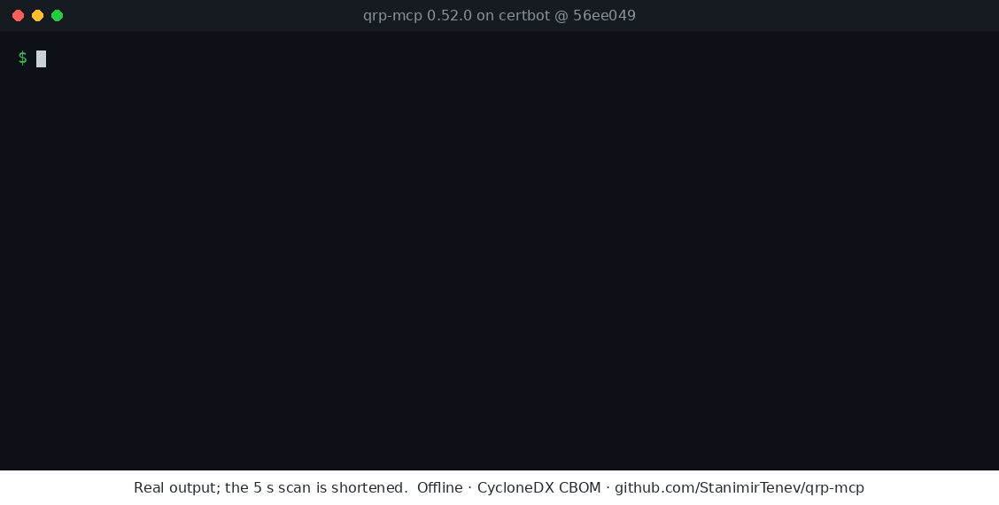
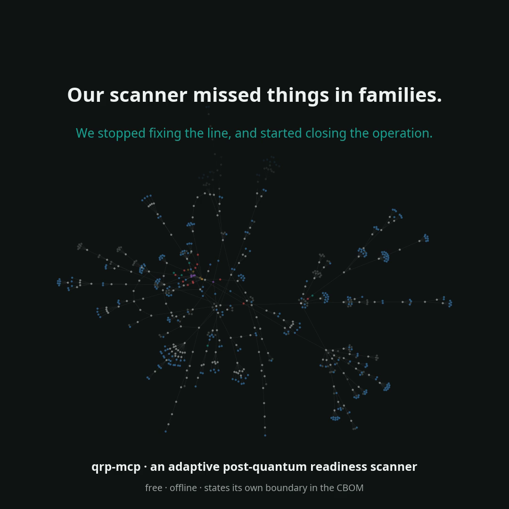
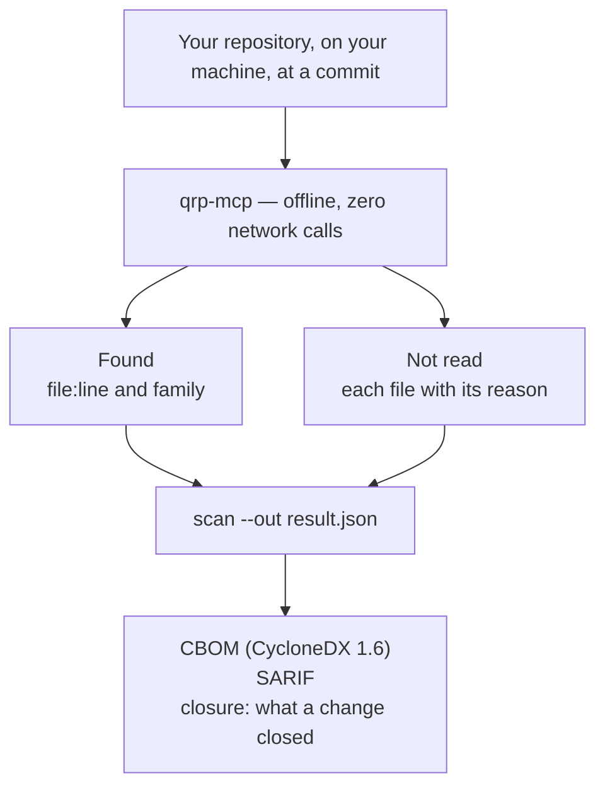

# qrp-mcp

<!-- mcp-name: eu.quantumreadiness/qrp-mcp -->

**Offline post-quantum scanner for code: CycloneDX CBOM, RNG calls next to keys, what it did not read.**


*22 s, the real output of `uvx qrp-mcp@0.52.0 scan` on certbot at `56ee049`, read back with `jq` and drawn frame by frame from that recording; the 5 s scan is shortened.*

What it says about [certbot](https://github.com/certbot/certbot) at `56ee049`, trimmed from
`qrp-mcp scan` (qrp-mcp 0.51.0): what it found, by role, and the files it did not read, with the
reason.

```json
"verdict": "This scan read 850 of 1250 files (68.0%); the remaining 400 (3 of 20, by extension — files with no extension, .rst and .txt — being 76.14% of them) are listed with a reason each.",
"summary": {"pqc_readiness": "hybrid_partial", "by_role": {
  "key_establishment": {"families": ["DH", "ECDH", "ML-KEM", "X25519", "X448"], "pqc_readiness": "hybrid_partial"},
  "signature": {"families": ["DSA", "EC", "ECDSA", "Ed25519", "Ed448", "ML-DSA", "RSA"], "pqc_readiness": "hybrid_partial"}}},
"coverage": {"not_examined": [
  {"reason": "type_not_claimed", "count": 352, "by_extension": {"(no extension)": 147, ".rst": 97, ".txt": 24, "...": "..."}},
  {"reason": "symlink_not_followed", "count": 48, "...": "..."}]}
```

[](https://github.com/StanimirTenev/qrp-mcp/blob/main/docs/media/gap-network.mp4)
*34 s: the fix list drawn as a network, and why closure is by operation. The method and the closure savings theorem: Tenev (2026), Zenodo, [doi:10.5281/zenodo.24336932](https://doi.org/10.5281/zenodo.24336932).*

Every signature in your wallet, contract and validator rests on elliptic-curve cryptography, and
a large quantum computer breaks it. Plenty of tools will tell you what they found. This one also
tells you what it read, what it could not read, and which question it is not answering — in the
document itself, where an auditor can check it rather than take your word.

An MCP server that scans a local directory for cryptography that Shor's algorithm defeats —
secp256k1, Ed25519, BLS, Schnorr, RSA — plus weak primitives and CI signing commands, and
classifies each one: broken by a quantum computer, post-quantum, or neither.

**Everything runs on your machine.** No network calls, no account, no API key, nothing
uploaded. A tool that reads your keys' surroundings has no business phoning home, so this one
makes zero outbound connections — enforced by a test, not promised in a paragraph. The only process it
starts is a local `git`, to pin what it read, with the scanned repository's own hooks and filters disarmed.



Need a cryptographic inventory (a CBOM) for a post-quantum migration or an audit, without
uploading your code? One command, no install step:

```
uvx qrp-mcp scan ~/code/my-project --out result.json
```

What comes back, run on this repository's own test fixtures -- the findings, and next to them
what the scan did not read:

```text
"verdict": "This scan read 24 of 27 files (88.89%); the remaining 3 (1 of 1, by extension
            — .b64 — being 100.0% of them) are listed with a reason each."
"summary": { "total_findings": 10, "quantum_vulnerable_count": 6, "pqc_ready_count": 1,
             "weak_count": 1, "pqc_readiness": "hybrid_partial", ... }
```

## Why this matters for chains and wallets

Bitcoin and Ethereum authenticate with **ECDSA over secp256k1**. Solana, Cardano and Polkadot
use **Ed25519**. Ethereum's consensus layer aggregates with **BLS12-381**. Taproot adds
**Schnorr**.

All four are public-key schemes whose security rests on discrete-log hardness — and all four
fall to the same quantum algorithm. The practical consequence is specific: **once a public key
is exposed, the private key becomes derivable.** Reused addresses, on-chain public keys,
and long-lived validator keys are where that exposure already exists today.

None of this is a prediction about dates. It is an inventory question: *which of my code paths
sign with what?* That question has an answer right now, and this tool gives it.

## Quick start

Add it to your MCP client — no installation step, `uvx` fetches and runs it:

```json
{
  "mcpServers": {
    "qrp": {
      "command": "uvx",
      "args": ["qrp-mcp"]
    }
  }
}
```

Then ask your agent:

> Scan ~/code/my-protocol for quantum-vulnerable cryptography.

### As a Claude Code plugin

The same server, packaged with a skill, so there is no config file to edit:

```
/plugin marketplace add StanimirTenev/qrp-mcp
/plugin install qrp@quantumreadiness
```

Then `/qrp:pqc-scan` in any project. Both routes need [`uv`](https://docs.astral.sh/uv/) on
your PATH, since `uvx` is what fetches and runs the server.

### Without an agent: write the result to a file

```
uvx qrp-mcp scan ~/code/my-protocol --out result.json
```

This produces the same result as the `scan_repo` tool, written to a file you can read
before it goes anywhere. Nothing is sent. By default (from 0.40.0, as `cbom` since 0.16.0 and
the tools) the quoted line is masked: everything in it but the algorithm name is starred out.
`--level full` writes the line as it is, and `--level trimmed` removes the line altogether; all
three keep each file and line number. The SHA-256 of the written bytes is printed,
so anyone you send the file to can quote back exactly what they received.

That digest is the file's integrity, and the file holds its read times, so two runs over one
commit print different ones. Beside it, `findings sha256` is the fingerprint of the findings
alone (`findings_fingerprint` in the JSON, in SARIF's run properties and in the CBOM as
`qrp:findings_fingerprint:sha256`): the same on every run and at every `--level` that finds the
same, different when a finding is added or removed. Its normalisation rules are written into the
output beside it: each finding as family, raw value, classification and severity; each
occurrence as category, path, line, family, role and key size; excerpts, confidence, owners,
baseline state, mandate clauses, suppressed rows, coverage and the read window left out; both
lists sorted, serialised as compact JSON with sorted keys, SHA-256 in hex. It says the result
repeats; it says nothing about whether the result is complete.

```
uvx qrp-mcp cbom ~/code/my-protocol --out cbom.json
uvx qrp-mcp closure before.json after.json --out closure.json
```

`cbom` writes the same CycloneDX document as the `export_cbom` tool, masked by default because
it is the document built to be sent. `closure` writes the `prove_closure` verdict for two saved
scans, and names both inputs by their SHA-256, so the three files can be tied together by
whoever receives them. Both print the SHA-256 of what they wrote.

### A control on your own tree

```
uvx qrp-mcp control ~/code/my-protocol --seed 1 --out control.json
```

From 0.43.0. The tree is copied to a temporary directory, known cryptographic uses (9 styles) and
lines that name an algorithm without using it (7 kinds) are planted into the copy, and the copy
is scanned with the same instrument. The result says which planted lines were found, which were
missed and which non-uses were reported as uses — **robustness on known patterns**, for this
version. It is not a statement about what your tree contains, and it never makes the coverage
claim stronger. `scan --control-seed N` carries the block in the result. [The control](https://github.com/StanimirTenev/qrp-mcp/blob/main/docs/control.md).

### A source scan against the build

```
uvx qrp-mcp scan ~/code/my-service --out scan.json      # before building
uvx qrp-mcp build-gap scan.json ~/code/my-service/bin/publish --out gap.json
```

From 0.44.0. Of K public-key-bearing packages or modules in the build, the source scan named J;
the K - J list; the families on one side only; and a Go binary's `DefaultGODEBUG` crypto
settings as recorded. It reads only tables the toolchain wrote (`*.deps.json`, .NET metadata
names, `go version -m`, `go tool nm`), never code, and never a key size from the build —
**robustness on known patterns**, not recall or coverage of the build. [Source against build](https://github.com/StanimirTenev/qrp-mcp/blob/main/docs/build-gap.md).

### In GitHub code scanning

From 0.54.0 the repository is also a GitHub Action. It runs
`uvx --from qrp-mcp==<this release> qrp-mcp scan PATH --format sarif --out FILE --level LEVEL` on
the runner, and `upload-sarif` puts the results in the Security tab:

```yaml
name: qrp-mcp
on: [push, pull_request]
permissions:
  contents: read
  security-events: write
jobs:
  scan:
    runs-on: ubuntu-latest
    steps:
      - uses: actions/checkout@v4
      - uses: StanimirTenev/qrp-mcp@v0.53.0
        id: qrp
        with:
          path: "."               # default; SARIF locations are relative to it
          level: masked           # default; full or trimmed
          output: qrp-mcp.sarif   # default
      - uses: github/codeql-action/upload-sarif@v4
        with:
          sarif_file: ${{ steps.qrp.outputs.sarif }}
          category: qrp-mcp
```

The inputs are only those `scan` already has; there is no "fail on" switch, and the step exits 0
on findings. Every file not read is in the SARIF as a tool execution notification with its
reason. Locations are relative to `path`, and code scanning reads them from the repository
root, so keep `path` at `.` when uploading.

## How it adapts

**An adaptive post-quantum readiness scanner.** It closes operations against a catalogue of their
documented spellings, each with a test, says in its output which (operation, ecosystem) pairs are
closed, and carries its coverage and limits inside the CBOM. A maintainer tool in the repository
re-reads the documentation and proposes new spellings, which enter only with a source and a test.

"Adaptive" means one thing here: the operations in the scanner's catalogue are tested against the
documentation of the libraries and formats the catalogue cites, and a maintainer tool re-reads that
documentation for spellings the catalogue does not hold yet. The scan itself stays deterministic
and offline. Nothing is learned at run time, and no rule enters the scanner without a source and a
test.

- **An operation is closed, not a line.** For each of its (operation, ecosystem) pairs, the
  package carries a catalogue of the documented spellings (`src/qrp_mcp/data/operations/*.toml`),
  each with the page it comes from and the words quoted from it. Every spelling is a test: it is
  written to a file, scanned, and expected on its line (`tests/test_operation_closure.py`). In
  0.53.0 the catalogue holds 29 pairs and 1,848 sourced spellings: IKE/IPsec; public-key names in
  C, Java and .NET; key sizes in PKI, .NET, Java, C and Python; key files and post-quantum keys and
  certificates in PKI; signing in .NET and in CI; symmetric and hash choices in .NET; TLS endpoints
  and TLS groups in nginx-style configuration; SSH algorithms; liboqs and hash-based signatures
  in C; Python dependencies and environment reads, and environment and GODEBUG settings in Go;
  ECVRF (RFC 9381) in Go and Rust; and `rng_source` in seven ecosystems (48 spellings), the random
  number generators the code calls, below. From 0.53.0 a spelling can carry `variants`, the same
  spelling with its free parts (a variable, setting or receiver name) changed, each its own test:
  two gaps inside closed pairs (rows 540, 546) came from a catalogue that held those parts fixed.
- **`randomness`: the generators the code calls, as context.** Each generator API called on a line
  is a row in one of three classes, from the generator's own documentation: `weak` (a non-cryptographic
  PRNG: Python `random` and `numpy.random`, Go `math/rand` and `math/rand/v2`,
  `java.util.Random`, `ThreadLocalRandom`, `Math.random`, C `rand`/`srand`, `std::mt19937`,
  `System.Random`, PHP `rand`/`mt_rand`), `csprng` (a named cryptographic generator: `secrets`,
  `os.urandom`, `crypto/rand`, `SecureRandom`, `crypto.getRandomValues`, `getrandom`,
  `arc4random`, `RAND_bytes`, `RandomNumberGenerator`, `random_int`) or `check` (a call its
  documentation does not settle by itself: `std::random_device`, SHA1PRNG with `setSeed`, a
  literal seed into a CSPRNG API, Go's ChaCha8, a generator named in a variable). A `weak` or
  `check` row in the same line, function or file as a public-key operation the scan reports, or
  assigned to a name that says key, seed, nonce or iv, is a **place to check** with its
  `link_scope`. The link is co-location: no value is followed from the generator to the key, and
  a place is not a verdict. Where ML-KEM or ML-DSA has a generator in the same function, the
  section names the FIPS 203 (3.3) or FIPS 204 (3.6.1) requirement, quoted with its page and the
  minimum strength per parameter set, and says it is named, not checked. `not_read` says what a
  code scan cannot know (entropy at boot, VM and container entropy, an HSM's generator, a generator
  injected at run time, a seed from configuration, statistical quality); no entropy is estimated
  and no test is run. None of this is a finding: it moves neither the findings, their
  fingerprint, a gate nor the exit code. In the CBOM it is `qrp:randomness:*` properties, and a
  `drbg` component where the DRBG family is named on the line, nowhere else (OpenSSL's
  `EVP_RAND_fetch(..., "CTR-DRBG", ...)`). Pattern rules for weak generators are already free and
  widespread (Bandit B311, gosec G404, FindSecBugs, CA5394, Semgrep), and CodeQL and Sonar S2245
  link a weak generator to sensitive use. This section carries the class from each generator's
  documentation, the FIPS requirement beside ML-KEM and ML-DSA, and what is not read, in the same
  output as the inventory.
- **`operation_closure`** in the result lists those pairs, with `spellings_count` and the
  catalogue version. It says what this version was tested against, not what your code contains.
  It does not enter the findings, their fingerprint, a gate or the exit code.
- **`ecosystems`, `angles`, `chosen_outside_files.leads`, `where_to_look`.** These sections
  are read from the finished result and change no row of it:
  - `ecosystems` names every ecosystem among the files read, with the rule that put it there, and
    says `closed`, `partially_closed` or `not_closed` against the catalogue, with "here we may
    miss" where it is not closed; from 0.53.0 `not_attributed` counts and lists the files read
    that no rule puts in any ecosystem, with the same "here we may miss" (also in the CBOM);
  - `angles` sets dependency, code and configuration against each other: "declared, not seen",
    "seen, not declared", and `not_compared` where the imports of an ecosystem are not read (Go,
    Rust, Java, .NET, Ruby, PHP);
  - `leads` follows an `include`, a key file path or a key path read from the environment to the
    files read, and says where each one ends (`followed`, `outside_the_tree`, `not_found`,
    `templated`, `read_at_run_time`, `pattern_not_followed`, ...). Nothing new is opened, so a lead
    adds no finding;
  - `where_to_look` puts the three in one list, production code first.

  `operation_closure` and these four sections are in the scan JSON, the `scan_repo` tool and
  `scan --out`. The SARIF does not carry them; the CBOM carries only `not_attributed`.
- **Self-tuning, for the maintainer.** `tools/catalogue_refresh.py` is in the repository, not in
  the installed package, and is run by hand. It fetches each page the catalogue cites (or reads a
  saved copy with `--pages`), looks for names with that page's own pattern, and writes what the
  catalogue does not hold as candidates. Each candidate is an expected-failure test
  (`tests/test_operation_candidates.py`). Every page also carries a positive control (a name the
  catalogue knows, which must be read) and a negative one (a name that exists nowhere, which must
  not be). A page where the negative control is read is named as not discriminating, and its
  candidates are not run.

**The boundary.** Self-tuning proposes; a person or an agent confirms, with a source and a
quotation, and after that a candidate becomes a closure test. In the first judged round, of
the 119 candidates the scanner was silent on, 21 were real spellings of their operation and 12 of
those were gaps the scanner missed (they are closed in 0.50.0); the other candidates were noise or
unclear. That figure is for those 119, not for all the candidates. Under the strict rule an
ecosystem is closed when the catalogue holds every operation in which a gap has been recorded
for it; in 0.53.0 two are, PKI and Go, and the others are `partially_closed` or `not_closed`. A spelling the
documentation does not list, or a page the catalogue does not cite, can still be missed.

Why the operation and not the line, and what waiting for the first report costs, is set out in
Tenev, S. (2026), *Close the operation, not the line: a closure savings formula for maintaining a
cryptographic-inventory scanner*, version 1.0, Zenodo,
[doi:10.5281/zenodo.24336932](https://doi.org/10.5281/zenodo.24336932). `CITATION.cff` in this
repository gives the same reference.

## What it reads

Every file under the path is either read or named with the reason it was not. The full list of
rules, file types and their limits is in [What it looks at](https://github.com/StanimirTenev/qrp-mcp/blob/main/docs/what-it-reads.md).

| Kind | Read as |
| --- | --- |
| Source code | C and C++, C#, Visual Basic and F#, Go, Rust, Java, Kotlin, Scala and Groovy, Swift (from 0.47.0: CryptoKit's `P256.Signing`/`.KeyAgreement`, `Curve25519.Signing`, the Security framework's `kSecAttrKeyTypeECSECPrimeRandom`, from 0.49.0 `kSecAttrKeyTypeRSA`), Python, JavaScript and TypeScript, Ruby, PHP, Perl, Solidity, Move and Cairo |
| Scripts | `.sh`/`.bash`/`.zsh`/`.ksh`, `.bat`/`.cmd`, PowerShell `.ps1`/`.psm1`/`.psd1` — algorithms, and signing commands as a pipeline's are |
| CI/CD pipelines | signing commands (`gpg --sign`, `--detach-sign`/`-b` and `--clearsign` (from 0.49.0), `cosign sign`, `signtool`, `jarsigner`, `codesign`, Secure Boot and kernel-module signing, firmware signing with `mkimage -k`/`-G`/`-K`, `binman sign` and `imgtool sign`, and from 0.47.0 keys in hardware: `tpm2_sign`, `pkcs11-tool --sign`, `openssl pkeyutl -sign`), with the key they name, `key_location` (`file`, `tpm`, `pkcs11_token`, `kms`, from the command, an `-engine`/`-provider pkcs11` or `tpm2`, a `pkcs11:` URI without its query or PIN, or cosign's `awskms://`/`gcpkms://`/`azurekms://`/`hashivault://`), and where that key is not a file the scan read, `key_algorithm`: the algorithm the line names (`-a sha256,rsa4096`) or "not determined: key not in the files read"; encryption to a public key (`gpg --encrypt`, `openssl smime`/`cms`/`pkeyutl -encrypt`, `age -r`), with the recipient key where it is in the tree |
| Infrastructure as code | Terraform/HCL (an `aws_kms_alias` and its `aws_kms_key` tie a composite signature declared beside KMS aliases to its two keys), Kubernetes manifests and Helm (`.tpl`, `.gotmpl`), Dockerfiles (including the crypto libraries a `RUN` installs) |
| TLS, SSH and VPN configuration | nginx, Apache, HAProxy, Caddy, Envoy, Istio, Traefik, Ingress-NGINX, Postfix, Dovecot, MySQL, PostgreSQL, Kafka, ZooKeeper, OpenVPN, WireGuard, strongSwan, OpenSSH (`sshd_config` and its variants), `openssl.cnf` (keys, digest and protocol bounds), `java.security`, Vault, IBM MQ (`.mqsc`), AWS load-balancer policies, OPC UA |
| Device configuration | FortiOS backups, Cisco IOS and Junos — read in part, and named as read in part with what was and was not read |
| Firmware signing | U-Boot FIT image sources and device trees (`.its`, `.dts`, `.dtsi`, `.dtso`: `algo = "sha256,rsa3072"`), board `*_defconfig` files (`CONFIG_RSA=y`; `# CONFIG_… is not set` is a switch off) — by the algorithm rules only; MCUboot's `SIGN_EC256`/`SIGN_EC384` (ECDSA P-256/P-384) and `ENC_EC256` (ECIES-P256, read as ECDH P-256), and `ec-p256` as the value of a `SIGN_KEY_FILE`/`SIGNATURE_KEY_FILE` setting |
| Windows | `.reg` exports (SCHANNEL), `web.config`/`app.config`/`applicationHost.config`, MSBuild `.vcxproj`/`.props`/`.targets`, WiX `.wxs`, certreq `.inf`, `.snk` strong-name keys |
| Certificates and keys | PEM and DER (`.pem`, `.der`, `.crt`, `.cer`, `.key`, `.pub`, …), PEM inside any text file or source string, base64 certificates in a Kubernetes TLS Secret, `.p12`/`.pfx`, Java keystores, SSH keys (OpenSSH private keys by their key type), `authorized_keys`, `known_hosts`, OpenPGP keys and signatures, JWKS, BIND DNSSEC key and zone files, Apple `.plist`, Chromium vboot `.vbprivk` (`.vbpubk`/`.keyblock` named as not decoded), public keys written as byte arrays (MCUboot's `*-rs.txt`), from 0.49.0 private keys written as a C byte array in source, and `.env` files (`.env`, `.env.production`), read as configuration for the private key they can hold |
| Manifests and lockfiles | the dependencies that bring cryptography in, by ecosystem (npm, PyPI, Cargo, Go, Maven/Gradle, NuGet, RubyGems, CocoaPods, SwiftPM, deb/apk/rpm in a Dockerfile) |
| Not read, on purpose | documentation (`.txt`, `.md`, `.rst`, `.pod`), binaries and images — counted and named, never silently left out |

A name is not a use. A post-quantum name that only names something the file defines
(`self.mlkem_key = ec.generate_private_key(...)`, `def kyber_exchange`) is an identifier row and
does not make a file post-quantum ready; a file that also calls the library keeps every row as it
was ([details][docs-what-it-reads]).
A name that only spells like a family is not one: `MLDSA1R` (an SH7722 register) is not ML-DSA,
tinycrypt's `ecc_dsa` is ECDSA, not DSA, and `#define MBEDTLS_REMOVE_3DES_CIPHERSUITES` is a
removal, not a use. A call inside `with pytest.raises(...)` or `with self.assertRaises(...)` whose
block names a key size (`key_size=1024`) is attempted in order to fail, and is not a use either; a
block without one (`pytest.raises(InvalidSignature)` over a `verify`) is a use; a function defined inside a test whose
docstring makes it a rejection test ("... is rejected.") still runs what it calls.

## Measured

Five trees this project did not write, scanned on 25 Nov 2026 with the 0.54.0 detection code
(popravki-054 at `5316656`, before the release merge), `scan --level full --no-config
--as-of 2026-11-25`: OWASP Juice Shop at `c9f9922` and DVWA at `502ac15` (shallow clones of
their default branches), OpenSSH at `7fe3b24`, certbot at `56ee049`, Vault at `41e571b`.
`coverage_pct` is the share of the files present that were read; `read_in_full_pct` leaves out the
files read only in part (a device configuration, a certificate block that did not parse).
Findings are the entries of `findings` (one per family and value), Weak is `summary.weak_count`,
Occurrences are the rows of `evidence` (one per file, line and family), and Read is how many of
those were opened in the file and judged by hand.

| Repository | Files present | Read | `coverage_pct` | Read in part | `read_in_full_pct` | Findings | Weak | Occurrences | Read by hand |
| --- | ---: | ---: | ---: | ---: | ---: | ---: | ---: | ---: | ---: |
| Juice Shop | 1,498 | 936 | 62.48% | 2 | 62.35% | 11 | 6 | 393 | 393 |
| DVWA | 252 | 191 | 75.79% | 0 | 75.79% | 2 | 1 | 34 | 34 |
| OpenSSH | 873 | 742 | 84.99% | 5 | 84.42% | 76 | 55 | 9,352 | 30 |
| certbot | 1,250 | 850 | 68.00% | 0 | 68.00% | 41 | 28 | 769 | 30 |
| Vault | 9,281 | 5,437 | 58.58% | 9 | 58.49% | 74 | 62 | 3,816 | 30 |

**DVWA**, all 34 read: all 34 are uses. 31 are MD5: password hashing in the login and in every
security level, the seeded user rows, a CSRF session token, a weak-session-id cookie, a client-side
token. 3 are AES-128-ECB. No false positive. Seen in the tree and not reported by this version:
AES-128-CBC (`token_library_high.php:4`), AES-GCM and SHA-256, and the minified MD5 implementation
on one line (`javascript/source/low.php:10`; its call on line 18 is reported).

**Juice Shop**, all 393 read. The 215 rows in UI translation files were checked by key (five keys
in 44 files), and the English, German, Korean and Chinese files line by line.

- 31 are uses: RS256 signing with an embedded RSA private key (`lib/insecurity.ts`), MD5 password
  hashing, HMAC-SHA1, an ALB TLS policy in Terraform, the WebAuthn algorithm list, OpenPGP EdDSA
  signatures, and P-256 keys in tests.
- 28 are a library that implements the family (ethers, jsonwebtoken), declared, imported or called
  with the browser wallet's signer. The line itself holds no signature.
- 11 only name the family: comments, test titles, a key file's URL. The scanner marks 10 of them as
  named, not used.
- 6, all in test code, are cryptography of another family. DSA is reported for an ECDSA
  `crypto.sign` with `dsaEncoding`. ECDH is reported for a `createECDH` that only makes a P-256
  signing key.
- **317 are false positives, all ECDSA.** 307 are the word `web3` in route paths, file and
  component names, tags, test titles and the 215 translation strings. 10 are ethers unit helpers
  (`formatEther`, `parseUnits`). The scanner marks 77 of the 317 as named, not used, at low
  confidence. It reports the other 240 at medium or high confidence.

**OpenSSH, certbot, Vault**: there are too many to read them all. 30 of each were read: the
occurrences sorted by category, path, line and family, then every k-th from the first (k = 312,
26 and 128). The rule was fixed before any of them was read. These counts describe those 30 lines
only; nothing is inferred from them about the rest.

- **OpenSSH**: 25 uses, 5 only named. The scanner marks 3 of the 5 (generated comments) as named.
  It reports the other 2 at medium or high confidence: a `CKM_DSA_SHA512` constant in `pkcs11.h:546`
  that no `.c` file uses, and a test title string in `regress/unittests/sshkey/test_file.c:440`.
- **certbot**: 24 uses, 1 library import, 5 only named. The scanner marks 4 of the 5 as named. It
  reports the fifth at medium confidence: `X25519PublicKey` in a type annotation
  (`crypto_util.py:358`).
- **Vault**: 26 uses, 1 declared dependency, 3 only named. The scanner marks all 3 as named.

These are reading figures and counts of lines read, not detection figures. How well the rules find
what is there is a different question. The measurements made of it, each with its date and
version, are in
[How it is measured](https://github.com/StanimirTenev/qrp-mcp/blob/main/docs/measurement.md). No
recall or precision figure is cited here as current.

## Added in 0.46.0 to 0.49.0

From 0.46.0 a TLS version a file pins is linked, in CycloneDX's own fields, to what the same file
configures: the TLS groups in `protocolProperties.cryptoRefArray`, and the cipher suites in
`protocolProperties.cipherSuites` by their IANA names, each pointing at the algorithms it names. A
reader that skips `qrp:` properties can resolve the key exchange of `TLS 1.3`
([details][docs-cbom]).

From 0.47.0 an algorithm read only from the name of a certificate or key file a TLS setting loads
(`ssl_certificate /etc/nginx/certs/mldsa65_srv.crt;`) is marked `named_in_a_path: true` and is one
confidence level lower: the file's name is a label, not the certificate.

From 0.47.0 `tls_listeners` lists each nginx `server` block that listens with `ssl` or `quic`: its
ports, server names (masked below `--level full`), the groups and the certificates set for it, with
each one's family, so two servers in one file no longer read as one inventory. The CBOM carries it
as `qrp:tls_listeners` ([details][docs-tls]).

From 0.48.0 `--mandate` also takes the deadlines of the EU (`eu-pqc-roadmap`), the UK (`uk-ncsc`),
Canada (`ca-cccs`), Australia (`au-ism`), the Netherlands (`nl-rqs`), Sweden (`se-ncsc`), Japan
(`jp-gov`), Singapore's CII owners (`sg-csa-cii`), India (`in-dst`) and Germany (`de-bsi`), each
quoted from the authority's own document, so a finding says which deadline catches it in each.
A date for a class of system the scan cannot see -- high-risk, highest priority -- is said beside
the clause and not counted by the gate. Every mandate block says how old its reading of the
document is, and past 180 days (`stale`) the command line says so
([details][docs-gate-and-suppression]).

From 0.49.0 `--mandate` also takes four financial regulators whose duty dates no line of code --
Bank of Israel (`il-boi`), FINMA (`ch-finma`), HKMA (`hk-hkma`) and MAS (`sg-mas`, a
consultation): the sector and the duty, quoted, with no clause on any occurrence and a gate that
never counts them. A mandate block also carries the sha256 of each document as it was read, and
`qrp-mcp mandate-check NAME --document FILE` says whether a copy you downloaded is still the same
document (the tool itself still fetches nothing)
([details][docs-gate-and-suppression]).

Four of the mandates also date symmetric or hash algorithms, which the scan does not read:
`cnsa-2.0` (AES-256 and SHA-384/512, already required), `au-ism` (AES-128/192, SHA-224/256 and
HMAC-SHA256 "will not be approved beyond 2030", for interoperability and maintainability reasons),
`ca-cccs` and `nist-ir-8547` (the 112-bit tail by 2030). From 0.49.0 their blocks say
`symmetric: not_established`, quoting the document, and a gate that would pass reads
`not_established` instead -- the exit code stays that of a pass. Before, AES-128 and SHA-256 code
passed `--mandate cnsa-2.0` in silence.

From 0.49.0 `trust_stores` lists each place that loads a trust store (Python `cafile`, Go
`AppendCertsFromPEM`, nginx `ssl_client_certificate`), the anchors read in it, and whether its
path is outside the tree; a strongSwan proposal that can be negotiated with a classical key
exchange alone is a row of its own (`evidence.ike_proposals`), so removing the fallback is
closed; a KMS SDK call (boto3 KMS, Azure Key Vault) says `key_location: kms`; and every evidence
row with a path says `in_test_code`
([details][docs-tls]).

From 0.47.0 `--mandate nist-ir-8547` also gives each clause `federal_high_value_assets`: the date
by role that NIST IR 8547 (section 4) restates from EO 14412 and OMB M-26-15 -- post-quantum key
establishment by 2030-12-31, signatures by 2031-12-31 -- for federal high value assets and high
impact systems only. The scan cannot tell which systems those are, so the gate does not count it
([details][docs-gate-and-suppression]).

From 0.47.0 an RSA, EC, ECDSA, EdDSA or DSA line that calls `.sign(`, `.verify(`, `.encrypt(` or
`.decrypt(` on a key carries `operation`, so verifying an old signature no longer reads the same
as signing a new one; in the CBOM as `qrp:operation`. Under `--mandate nist-ir-8547` a verify-only or decrypt-only line
says what IR 8547 calls legacy use, with no exemption: the dates and the gate are unchanged
([details][docs-closure-and-profiles]).

From 0.47.0 a call into a post-quantum KEM or signature API is a row with `operation` --
`keygen` apart from `encapsulate`, `decapsulate`, `sign` and `verify` -- so where a device
generates its own key is said with file and line: the NIST API of pqm4, PQClean and SUPERCOP
(`crypto_kem_keypair/enc/dec`, `crypto_sign_keypair`, `crypto_sign_signature`/`crypto_sign`,
`crypto_sign_verify`/`crypto_sign_open`), liboqs (`OQS_KEM_keypair/encaps/decaps`,
`OQS_SIG_keypair/sign/verify` and the per-scheme forms) and mlkem-native's namespaced
functions. Where the call does not name the scheme, the family is the one the same file names
(`family_named_at`), and a family named there only in a comment stays not used; a file naming
none or two gives no row. Declarations are not calls. Code
shows where a key is generated, not whether that step survives a fault.

From 0.47.0 RustCrypto's `ml_kem`, `ml_dsa` and `slh_dsa` crates and libcrux are named as the
`provider`, and Go's `mlkem.GenerateKey768()` and its siblings give the parameter set
([details][docs-what-it-reads]); so do
liboqs's SLH-DSA names (`SLH_DSA_PURE_SHA2_128S`, `SLH_DSA_SHA2_224_PREHASH_SHAKE_128F`).

From 0.47.0 an Android Keystore key (`KeyPairGenerator.getInstance(..., "AndroidKeyStore")`) takes
its role from the `PURPOSE_*` of the file's one `KeyGenParameterSpec.Builder`, and an EC key its
curve from `ECGenParameterSpec(...)` or `setKeySize(...)` there; where it sets neither, P-256 as the
Keystore's default, marked as such in `curve_basis` (CBOM `qrp:curve_basis`). Where the key lives
(StrongBox or TEE) is not read.

From 0.47.0 the CBOM names the scanned folder in `qrp:coverage:corpus:target` by its own name, not
its absolute path, so it no longer carries a path from your machine and one commit scanned in two
places gives the same bytes; the scan result (`scan --out`, `scan_repo`) still has the absolute path.

From 0.47.0 a public-key PEM (`PUBLIC KEY`, `RSA PUBLIC KEY`) that parses is read as a key, with
its size and curve, and marked `key_material: "public key"`; it is not counted as a committed
private key. U-Boot's FIT names `ecdsa256`/`ecdsa384`/`ecdsa521` give the key size, as `rsa2048`
already did.

From 0.47.0 the CBOM has one `related-crypto-material` component per key -- `type` `private-key` or
`public-key`, its `size`, `algorithmRef` and `qrp:curve` -- instead of one "Embedded private key
material" component for all the keys in the tree
([details][docs-cbom]).

From 0.47.0 an RSA line that encrypts a named value with OAEP (`pub.encrypt(archive_key,
padding.OAEP(...))`, on one line or split over up to four) carries `wraps`: the value's name (masked below `--level full`), and, where the
file assigns it once with `generate_key(bit_length=N)`, `os.urandom(n)`, `secrets.token_bytes(n)` or
`get_random_bytes(n)`, `what: "symmetric key"` and its size -- a symmetric key is as safe as the key
that wraps it. In the CBOM as `qrp:wraps`. AES itself is still not reported: symmetric cryptography
is out of scope by design ([measurement][docs-measurement]).
ECIES and AES key wrap under a DH-derived key are not read.

## Documentation

- [What it looks at](https://github.com/StanimirTenev/qrp-mcp/blob/main/docs/what-it-reads.md) — the rules, file types and formats, and their limits
- [What the coverage block says](https://github.com/StanimirTenev/qrp-mcp/blob/main/docs/coverage.md) — `coverage_pct`, `read_in_part`,
  `read_in_full_pct`, `examined_partly`, concentration
- [The CBOM it emits](https://github.com/StanimirTenev/qrp-mcp/blob/main/docs/cbom.md) — CycloneDX 1.6 fields, the kind of place a finding sits in,
  how sure the scan is of each occurrence
- [What a TLS line does not establish](https://github.com/StanimirTenev/qrp-mcp/blob/main/docs/tls.md) — TLS places, classical groups and SSH key
  exchanges offered on their own
- [Gate, mandates and suppression markers](https://github.com/StanimirTenev/qrp-mcp/blob/main/docs/gate-and-suppression.md) — `--mandate`,
  `--min-coverage`, `.qrp.toml`, `qrp:ignore` with `until=` and `owner=`
- [Closure, replacements and profiles](https://github.com/StanimirTenev/qrp-mcp/blob/main/docs/closure-and-profiles.md) — whether a fix closed it,
  what to replace it with, national profiles, the role of an RSA or EC line
- [The control](https://github.com/StanimirTenev/qrp-mcp/blob/main/docs/control.md) — `qrp-mcp control`, what it plants, the
  `self_seeded_control` block and its fields
- [Source against build](https://github.com/StanimirTenev/qrp-mcp/blob/main/docs/build-gap.md) — `qrp-mcp build-gap`, what it reads
  from a build, what it never reads, what K and J are
- [How it is measured](https://github.com/StanimirTenev/qrp-mcp/blob/main/docs/measurement.md) — the measurements, the corpora, what an outside
  review found, what is still missing
- [CHANGELOG](https://github.com/StanimirTenev/qrp-mcp/blob/main/CHANGELOG.md) — what changed in each version, newest first
- [Security policy](https://github.com/StanimirTenev/qrp-mcp/blob/main/SECURITY.md) — how to report a vulnerability privately.
  0.52.1 fixes a scanned tree running its own code in the readers (0.37.0 to 0.52.0); update to it

## What it is not

It reads source, configuration, CI pipelines, infrastructure-as-code, Kubernetes manifests,
build files, certificates and key inventories. It does not read documentation, binaries or
images; `build-gap` reads only the name tables a toolchain wrote into a build, never its code.

Every file under the path is accounted for in one of four ways: **scanned**, **unreadable**,
**skipped because the tool does not claim that type** — counted by extension, so
the coverage figure has a base, and from 0.27.3 named one by one in the coverage block (`not_examined` → `paths`) —
or **a link not followed**, named in `symlinks_not_followed`. `files_scanned + unreadable_files +
files_skipped_by_type` plus the linked files always equals `files_present`; until 0.34.0 this
sentence said three ways and left the links out. A directory the scan cannot enter or list is named in
`unreadable_directories`; its files cannot be counted, so the scan then says it cannot account
for every file instead of claiming it read them all. A scan that read seven files out of nine is a different report
from one that read seven out of four hundred, and only one of them is worth trusting.

A **free inventory tool**, not a readiness assessment. It deliberately does not do:

- risk scoring or prioritisation,
- migration planning — a `replacement` names what a finding becomes, not when or in what order,
- network or host scanning, or reading a system certificate store,
- tracking change over time — `prove_closure` compares two scans you give it; nothing keeps a history,
- symmetric cryptography, hashes and MACs, key derivation (PBKDF2, scrypt, Argon2, HKDF) or
  random number generation as a finding (SecureRandom, DRBG, `os.urandom`, `secrets`, `math/rand`, a
  remote entropy service) — out of scope by design: it reports the public-key cryptography a quantum
  computer would break. A file holding nothing else is read and gives no finding; the output says so
  in `coverage.claims.out_of_scope_by_design`. From 0.52.0 the generators the code calls
  are listed in `randomness` as context (above, "How it adapts"); the entropy behind them and the
  quality of a seed are not read. MD5, SHA-1, DES, 3DES and RC4 are still named where
  found. Four `--mandate` documents date AES or SHA sizes (`cnsa-2.0`, `au-ism`, `ca-cccs`,
  `nist-ir-8547`); under them the gate says `not_established` for symmetric rather than pass,
- which OpenSSL or other TLS library a base image carries: `FROM alpine:3.12` or
  `FROM ubuntu:16.04` says nothing about the OpenSSL inside it (only `nginx:1.24.0` is known); a
  package a `RUN` line installs is a dependency row with its version,
- the algorithm of a signature made by a KMS, Vault or an agent: such a call is a place in
  `chosen_outside_files` (`kind: remote_signing`), not a family,
- the algorithm a time-stamping authority signs an RFC 3161 token with: the request (`openssl ts
  -query`, rfc3161ng, Bouncy Castle, .NET) is a place (`kind: remote_timestamp`) that says the
  hash the request chose (`hash_choice`),
- fetching keys from a QKD key management entity (an ETSI GS QKD 014 client) or judging where a
  postquantum preshared key comes from beyond the files read.

The paid layer is the [DORA cryptography report](https://quantumreadiness.eu/dora-report/), made
from this scanner's masked output. Nothing here is crippled to push you there. What it does not cover is
said, not hidden: the scan writes its coverage and limits into the CBOM and claims no
completeness beyond them.

DORA: the scanner has no DORA profile. The [DORA cryptography report](https://quantumreadiness.eu/dora-report/)
is the paid layer, made from the scanner's masked output; the first one is free for EU financial
entities.

It also does not tell you that you are about to be hacked. It tells you what you are using.

## License

Apache-2.0.

[docs-cbom]: https://github.com/StanimirTenev/qrp-mcp/blob/main/docs/cbom.md
[docs-closure-and-profiles]: https://github.com/StanimirTenev/qrp-mcp/blob/main/docs/closure-and-profiles.md
[docs-gate-and-suppression]: https://github.com/StanimirTenev/qrp-mcp/blob/main/docs/gate-and-suppression.md
[docs-measurement]: https://github.com/StanimirTenev/qrp-mcp/blob/main/docs/measurement.md
[docs-tls]: https://github.com/StanimirTenev/qrp-mcp/blob/main/docs/tls.md
[docs-what-it-reads]: https://github.com/StanimirTenev/qrp-mcp/blob/main/docs/what-it-reads.md
