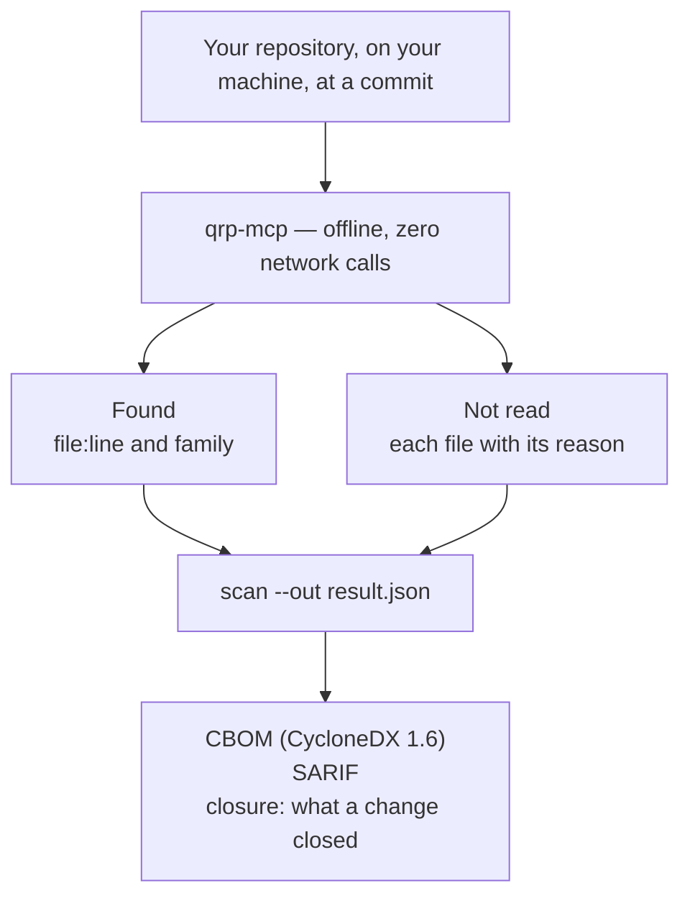

# qrp-mcp

<!-- mcp-name: eu.quantumreadiness/qrp-mcp -->

**A local cryptographic inventory for developers and AI agents that carries verifiable coverage
and its own limits inside the CBOM.**

Every signature in your wallet, contract and validator rests on elliptic-curve cryptography, and
a large quantum computer breaks it. Plenty of tools will tell you what they found. This one also
tells you what it read, what it could not read, and which question it is not answering — in the
document itself, where an auditor can check it rather than take your word.

An MCP server that scans a local directory for cryptography that Shor's algorithm defeats —
secp256k1, Ed25519, BLS, Schnorr, RSA — plus weak primitives and CI signing commands, and
classifies each one: broken by a quantum computer, post-quantum, or neither.

**Everything runs on your machine.** No network calls, no account, no API key, nothing
uploaded. A tool that reads your keys' surroundings has no business phoning home, so this one
makes zero outbound connections — enforced by a test, not promised in a paragraph. The only process it
starts is a local `git`, to pin what it read, with the scanned repository's own hooks and filters disarmed.



Need a cryptographic inventory (a CBOM) for a post-quantum migration or an audit, without
uploading your code? One command, no install step:

```
uvx qrp-mcp scan ~/code/my-project --out result.json
```

What comes back, run on this repository's own test fixtures -- the findings, and next to them
what the scan did not read:

```text
"verdict": "This scan read 24 of 27 files (88.89%); the remaining 3 (1 of 1, by extension
            — .b64 — being 100.0% of them) are listed with a reason each."
"summary": { "total_findings": 10, "quantum_vulnerable_count": 6, "pqc_ready_count": 1,
             "weak_count": 1, "pqc_readiness": "hybrid_partial", ... }
```

## Why this matters for chains and wallets

Bitcoin and Ethereum authenticate with **ECDSA over secp256k1**. Solana, Cardano and Polkadot
use **Ed25519**. Ethereum's consensus layer aggregates with **BLS12-381**. Taproot adds
**Schnorr**.

All four are public-key schemes whose security rests on discrete-log hardness — and all four
fall to the same quantum algorithm. The practical consequence is specific: **once a public key
is exposed, the private key becomes derivable.** Reused addresses, on-chain public keys,
and long-lived validator keys are where that exposure already exists today.

None of this is a prediction about dates. It is an inventory question: *which of my code paths
sign with what?* That question has an answer right now, and this tool gives it.

## Quick start

Add it to your MCP client — no installation step, `uvx` fetches and runs it:

```json
{
  "mcpServers": {
    "qrp": {
      "command": "uvx",
      "args": ["qrp-mcp"]
    }
  }
}
```

Then ask your agent:

> Scan ~/code/my-protocol for quantum-vulnerable cryptography.

### As a Claude Code plugin

The same server, packaged with a skill, so there is no config file to edit:

```
/plugin marketplace add StanimirTenev/qrp-mcp
/plugin install qrp@quantumreadiness
```

Then `/qrp:pqc-scan` in any project. Both routes need [`uv`](https://docs.astral.sh/uv/) on
your PATH, since `uvx` is what fetches and runs the server.

### Without an agent: write the result to a file

```
uvx qrp-mcp scan ~/code/my-protocol --out result.json
```

This produces the same result as the `scan_repo` tool, written to a file you can read
before it goes anywhere. Nothing is sent. By default (from 0.40.0, as `cbom` since 0.16.0 and
the tools) the quoted line is masked: everything in it but the algorithm name is starred out.
`--level full` writes the line as it is, and `--level trimmed` removes the line altogether; all
three keep each file and line number. The SHA-256 of the written bytes is printed,
so anyone you send the file to can quote back exactly what they received.

That digest is the file's integrity, and the file holds its read times, so two runs over one
commit print different ones. Beside it, `findings sha256` is the fingerprint of the findings
alone (`findings_fingerprint` in the JSON, in SARIF's run properties and in the CBOM as
`qrp:findings_fingerprint:sha256`): the same on every run and at every `--level` that finds the
same, different when a finding is added or removed. Its normalisation rules are written into the
output beside it: each finding as family, raw value, classification and severity; each
occurrence as category, path, line, family, role and key size; excerpts, confidence, owners,
baseline state, mandate clauses, suppressed rows, coverage and the read window left out; both
lists sorted, serialised as compact JSON with sorted keys, SHA-256 in hex. It says the result
repeats; it says nothing about whether the result is complete.

```
uvx qrp-mcp cbom ~/code/my-protocol --out cbom.json
uvx qrp-mcp closure before.json after.json --out closure.json
```

`cbom` writes the same CycloneDX document as the `export_cbom` tool, masked by default because
it is the document built to be sent. `closure` writes the `prove_closure` verdict for two saved
scans, and names both inputs by their SHA-256, so the three files can be tied together by
whoever receives them. Both print the SHA-256 of what they wrote.

## What it reads

Every file under the path is either read or named with the reason it was not. The full list of
rules, file types and their limits is in [What it looks at](https://github.com/StanimirTenev/qrp-mcp/blob/main/docs/what-it-reads.md).

| Kind | Read as |
| --- | --- |
| Source code | C and C++, C#, Visual Basic and F#, Go, Rust, Java, Kotlin, Scala and Groovy, Python, JavaScript and TypeScript, Ruby, PHP, Perl, Solidity, Move and Cairo |
| Scripts | `.sh`/`.bash`/`.zsh`/`.ksh`, `.bat`/`.cmd`, PowerShell `.ps1`/`.psm1`/`.psd1` — algorithms, and signing commands as a pipeline's are |
| CI/CD pipelines | signing commands (`gpg --sign`, `cosign sign`, `signtool`, `jarsigner`, `codesign`, Secure Boot and kernel-module signing), with the key they name |
| Infrastructure as code | Terraform/HCL, Kubernetes manifests and Helm (`.tpl`, `.gotmpl`), Dockerfiles (including the crypto libraries a `RUN` installs) |
| TLS, SSH and VPN configuration | nginx, Apache, HAProxy, Caddy, Envoy, Istio, Traefik, Ingress-NGINX, Postfix, Dovecot, MySQL, PostgreSQL, Kafka, ZooKeeper, OpenVPN, WireGuard, strongSwan, OpenSSH, `openssl.cnf`, `java.security`, Vault, IBM MQ (`.mqsc`), AWS load-balancer policies, OPC UA |
| Device configuration | FortiOS backups, Cisco IOS and Junos — read in part, and named as read in part with what was and was not read |
| Windows | `.reg` exports (SCHANNEL), `web.config`/`app.config`/`applicationHost.config`, MSBuild `.vcxproj`/`.props`/`.targets`, WiX `.wxs`, certreq `.inf`, `.snk` strong-name keys |
| Certificates and keys | PEM and DER (`.pem`, `.der`, `.crt`, `.cer`, `.key`, `.pub`, …), PEM inside any text file or source string, `.p12`/`.pfx`, Java keystores, SSH keys, `authorized_keys`, `known_hosts`, OpenPGP keys and signatures, JWKS, BIND DNSSEC key and zone files, Apple `.plist` |
| Manifests and lockfiles | the dependencies that bring cryptography in, by ecosystem (npm, PyPI, Cargo, Go, Maven/Gradle, NuGet, RubyGems, CocoaPods, SwiftPM, deb/apk/rpm in a Dockerfile) |
| Not read, on purpose | documentation (`.txt`, `.md`, `.rst`, `.pod`), binaries and images — counted and named, never silently left out |

## Coverage on three public repositories

What `coverage.scope` says on three trees this project did not write, measured on 4 Nov 2026 with
the code of this release (the repositories at OpenSSH `7fe3b24`, certbot `56ee049`, Vault
`41e571b`). `coverage_pct` is the share of the files present that were read; `read_in_full_pct`
leaves out the files read only in part (a device configuration, a certificate block that did not
parse).

| Repository | Files present | Read | `coverage_pct` | Read in part | `read_in_full_pct` | Findings | Weak |
| --- | ---: | ---: | ---: | ---: | ---: | ---: | ---: |
| OpenSSH | 873 | 741 | 84.88% | 5 | 84.31% | 70 | 54 |
| certbot | 1,250 | 850 | 68.00% | 0 | 68.00% | 39 | 28 |
| Vault | 9,281 | 5,421 | 58.41% | 9 | 58.31% | 74 | 62 |

These are reading figures, not detection figures. How well the rules find what is there is a
different question; the measurements made of it, each with its date and version, are in
[How it is measured](https://github.com/StanimirTenev/qrp-mcp/blob/main/docs/measurement.md), and no recall or precision figure is cited here as
current.

## Documentation

- [What it looks at](https://github.com/StanimirTenev/qrp-mcp/blob/main/docs/what-it-reads.md) — the rules, file types and formats, and their limits
- [What the coverage block says](https://github.com/StanimirTenev/qrp-mcp/blob/main/docs/coverage.md) — `coverage_pct`, `read_in_part`,
  `read_in_full_pct`, `examined_partly`, concentration
- [The CBOM it emits](https://github.com/StanimirTenev/qrp-mcp/blob/main/docs/cbom.md) — CycloneDX 1.6 fields, the kind of place a finding sits in,
  how sure the scan is of each occurrence
- [What a TLS line does not establish](https://github.com/StanimirTenev/qrp-mcp/blob/main/docs/tls.md) — TLS places, classical groups and SSH key
  exchanges offered on their own
- [Gate, mandates and suppression markers](https://github.com/StanimirTenev/qrp-mcp/blob/main/docs/gate-and-suppression.md) — `--mandate`,
  `--min-coverage`, `.qrp.toml`, `qrp:ignore` with `until=` and `owner=`
- [Closure, replacements and profiles](https://github.com/StanimirTenev/qrp-mcp/blob/main/docs/closure-and-profiles.md) — whether a fix closed it,
  what to replace it with, national profiles, the role of an RSA or EC line
- [How it is measured](https://github.com/StanimirTenev/qrp-mcp/blob/main/docs/measurement.md) — the measurements, the corpora, what an outside
  review found, what is still missing
- [CHANGELOG](https://github.com/StanimirTenev/qrp-mcp/blob/main/CHANGELOG.md) — what changed in each version, newest first

## What it is not

It reads source, configuration, CI pipelines, infrastructure-as-code, Kubernetes manifests,
build files, certificates and key inventories. It does not read documentation, binaries or
images.

Every file under the path is accounted for in one of four ways: **scanned**, **unreadable**,
**skipped because the tool does not claim that type** — counted by extension, so
the coverage figure has a base, and from 0.27.3 named one by one in the coverage block (`not_examined` → `paths`) —
or **a link not followed**, named in `symlinks_not_followed`. `files_scanned + unreadable_files +
files_skipped_by_type` plus the linked files always equals `files_present`; until 0.34.0 this
sentence said three ways and left the links out. A directory the scan cannot enter or list is named in
`unreadable_directories`; its files cannot be counted, so the scan then says it cannot account
for every file instead of claiming it read them all. A scan that read seven files out of nine is a different report
from one that read seven out of four hundred, and only one of them is worth trusting.

A **free inventory tool**, not a readiness assessment. It deliberately does not do:

- risk scoring or prioritisation,
- migration planning — a `replacement` names what a finding becomes, not when or in what order,
- network or host scanning, or reading a system certificate store,
- tracking change over time — `prove_closure` compares two scans you give it; nothing keeps a history.

Those live in the [Quantum Readiness Platform](https://quantumreadiness.eu), the product this
tool is extracted from. Nothing here is crippled to push you there — what it does, it does
completely.

It also does not tell you that you are about to be hacked. It tells you what you are using.

## License

Apache-2.0.
